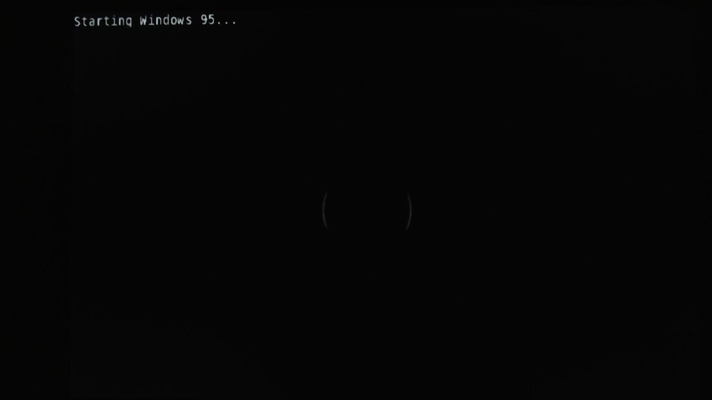
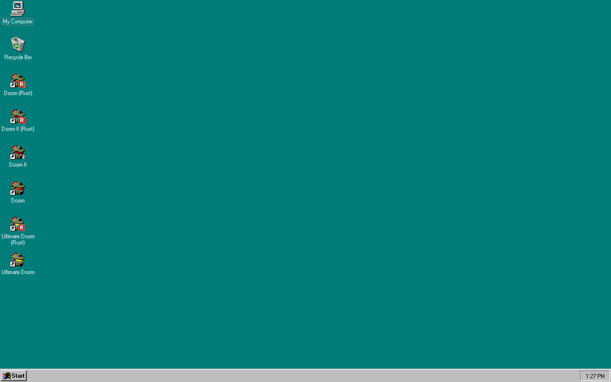
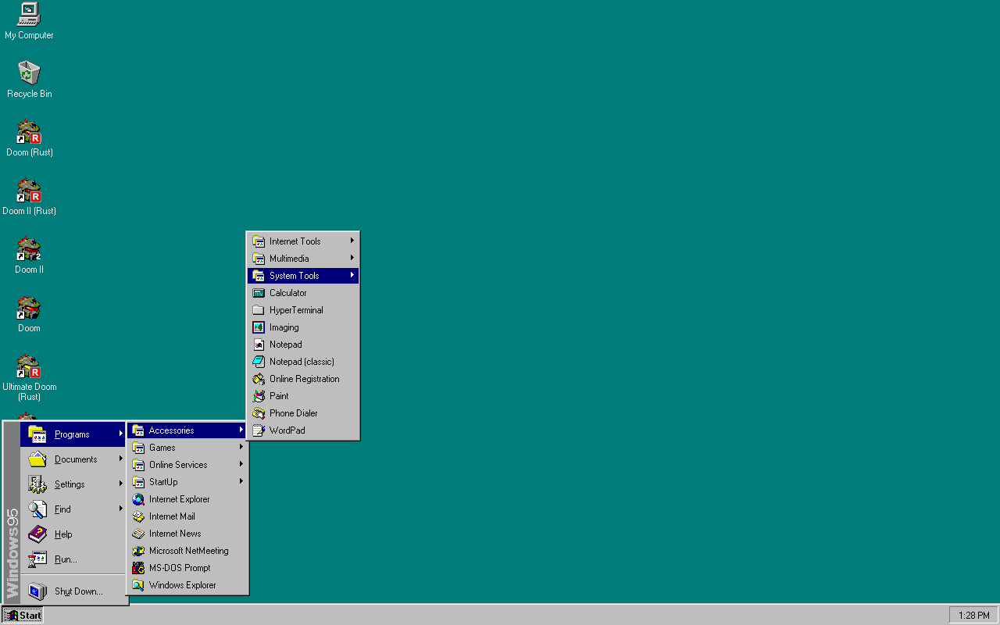
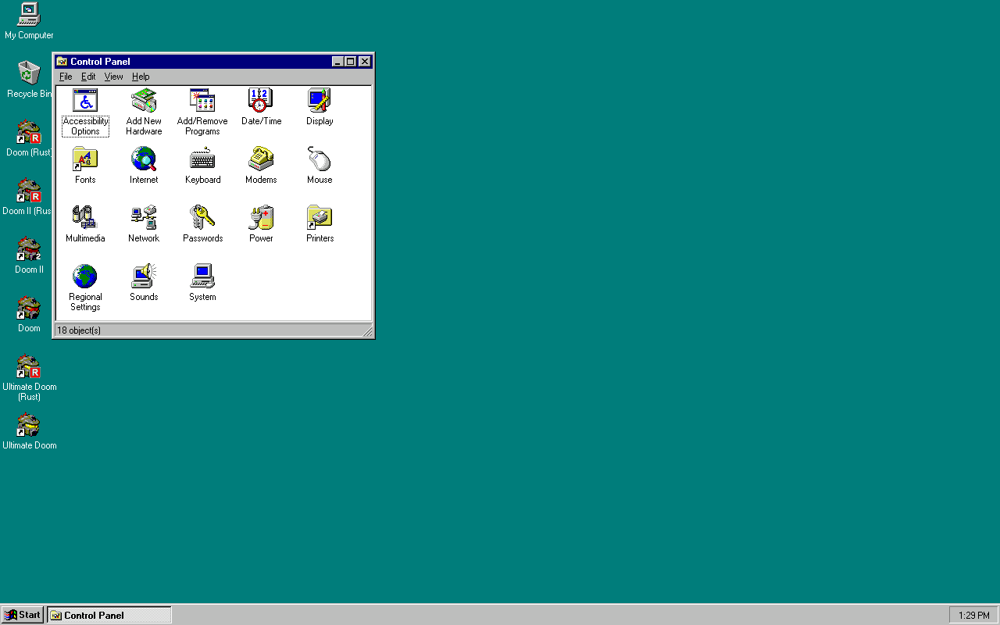
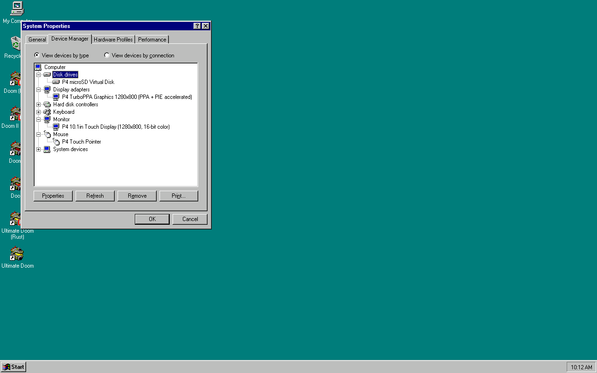
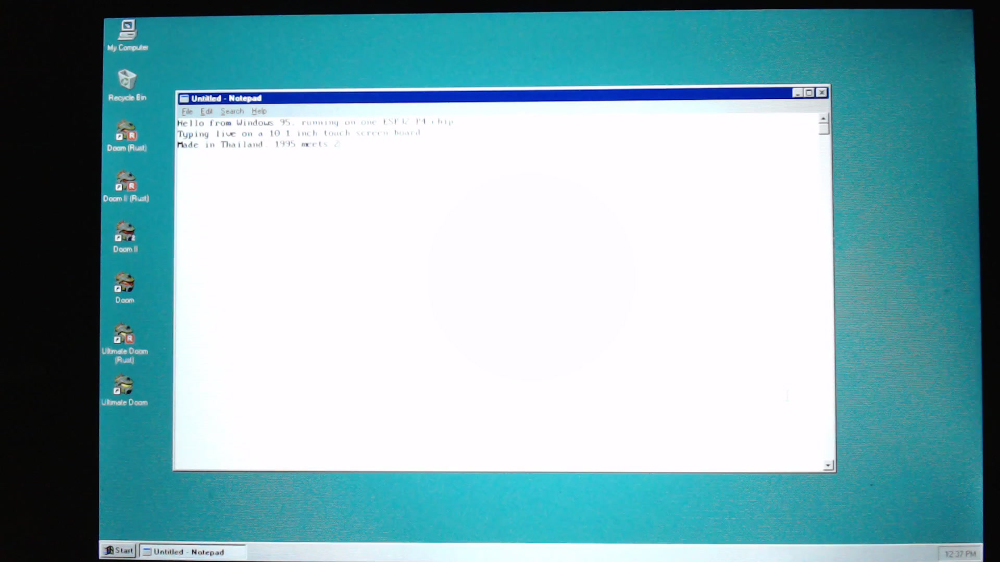
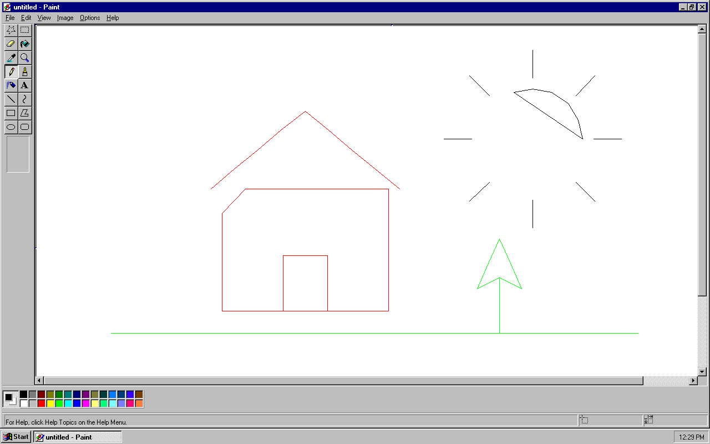
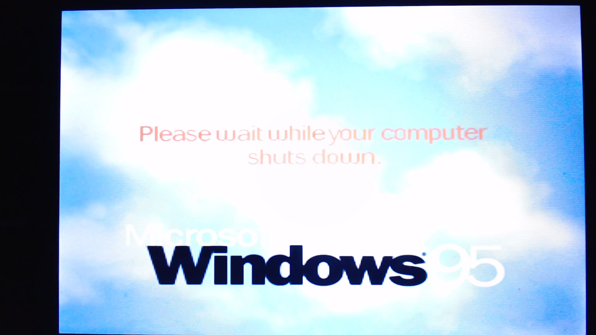
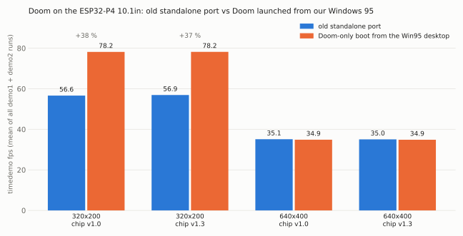
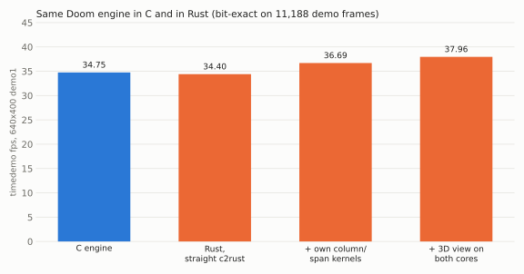

# Windows 95 on one ESP32-P4

*A hobby project about missing the 90s.*

Do you remember the teal desktop, the click of the Start button, the grey windows with blue title bars, typing a note in Notepad,
and that first evening with Doom? We do. This project brings that feeling back on a single small microcontroller board,
and shares what we learned with everyone around the world who lived those times (and everyone who is curious about them).

Windows 95 runs on one **ESP32-P4** chip (JC8012P4A1 board, 10.1" 1280x800 MIPI touch panel) through an x86 emulator based on
[tiny386](https://github.com/hchunhui/tiny386), with our own accelerated drivers inside Windows. **Doom** runs natively as a second
app on the same board, launched from icons on the Windows desktop. No PC, no x86 chip: one small RISC-V microcontroller, a microSD card and a screen.

| | |
|---|---|
|  |  |
|  |  |
|  |  |
|  |  |

Screenshots: 1280x800 captures of the guest screen, and camera photos of the panel (01, 06, 10). The Doom icons are our own drawings.

## Try it

- **Doom only, 5 minutes:** download `doom-only-kit.zip` from [Releases](https://github.com/winitboonkliang/win95-esp32p4/releases), flash 3 files, put the free shareware `doom1.wad` or [Freedoom](https://freedoom.github.io) on the SD card, power on.
- **Windows 95 + Doom:** `win95-doom-kit.zip` plus your own Windows 95 disk image.
- Step by step, troubleshooting and the full build: [docs/TRY_IT.md](docs/TRY_IT.md).

## Video

[](https://youtu.be/zey6aW1GAKo)

- **Short overview (about 5 min):** https://youtu.be/zey6aW1GAKo - power on, the Start menu, Control Panel, Device Manager, Notepad, Paint, Doom and the 40 min Ultimate Doom run (Thai narration, English subtitles).
- Full unedited take (54 min, includes the 40 min Ultimate Doom stability run): coming soon.

## What works today (22 Nov 2026)

- Windows 95 desktop at **1280x800, 65k colours** on the 10.1" panel, with our own display driver (`B29GFX.DRV`).
- **Touch screen as the pointer**: tap = click, double tap = double click, long press = right click, drag = drag (our `P4PTR.DRV`).
  USB keyboard and mouse work too.
- **Instant-on**: power on and Windows resumes from a "golden" desktop snapshot in **~0.5 s** (restore time). The system disk is read-only
  for the session, so pulling the plug cannot corrupt it. A cold boot to the desktop takes **~82 s**.
- **Notepad** rebuilt natively on the P4 (Rust), started from the normal Start menu entry; it runs without the x86 emulator doing the work.
- Control Panel, Device Manager (our devices show up as "P4 TurboPPA Graphics", "P4 Touch Pointer", "P4 microSD Virtual Disk"), Paint, Explorer.
- Windows clock follows the board's real-time clock: within **+-0.3 s** after a cold boot, after a resume and after a Doom round trip.
- **Doom, Ultimate Doom, Doom II** icons on the desktop (C engine, and the same engine in Rust). A double-click restarts the board into a
  Doom-only app that gets the whole chip. Quit, and you are back on the Windows desktop in **2.6 s**.
- Doom at 640x400 runs at **~35 fps** (Doom's own tic rate), with OPL music and sound effects through the board's ES8311 codec,
  USB gamepads (any HID pad, plus XInput), USB keyboard/mouse and an on-screen touch overlay. Saves go to the SD card.
- A 40-minute Ultimate Doom run on camera with no hang and no reset (22 Nov 2026).

## How it works (short version, details in [docs/ARCHITECTURE.md](docs/ARCHITECTURE.md))

```
 +-------------------------------- Windows 95 (your own licensed copy, on the SD card) -------------------------------+
 |  B29GFX.DRV display driver   P4PTR.DRV touch pointer   P4TIME / P4IDLE VxDs   B76 stub (Notepad window)            |
 +---------------------- paravirtual ports: Windows talks straight to the host, no legacy hardware on hot paths -------+
 | x86 emulator (tiny386-based, our CPU hot paths, own 64 KB BIOS + Rust BIOS services) .............. core 0         |
 | host: present (PPA rotate/scale + PIE SIMD rows), touch engine (Rust), disk overlay + golden snapshot,             |
 |       native Notepad (Rust), clock sync, sound ................................................... core 1         |
 +--------------------------------------------------------------------------------------------------------------------+
 | ESP32-P4 (2x RISC-V 360 MHz, PIE SIMD, PPA, 32 MB PSRAM) + JD9365 DSI panel + GSL3680 touch + ES8311 + microSD     |
 +--------------------------------------------------------------------------------------------------------------------+
   flash: factory = Windows app | ota_0 = Doom app (C + Rust engines) | own bootloader picks one via a retained register
```

- **The emulator runs on core 0**, the board services on core 1.
- **Display**: our Windows display driver draws into a linear 1280x800x16 surface; Windows drawing calls (BitBlt, text, DIB blits) are
  partly executed natively on the P4 with PIE SIMD row loops; the host sends only the changed rectangles to the panel with the
  **PPA** (the P4's 2D engine rotates and scales). The mouse cursor is a host overlay, not drawn by Windows.
- **Touch** goes through a Rust gesture engine straight into our pointer driver (absolute positions, 0 px error over 200 taps).
- **Golden snapshot**: once the desktop is idle the whole machine (RAM + devices) is saved compressed to the SD card; every power-on
  restores it. All disk writes go to a RAM overlay that spills to the SD card.
- **Doom** is a separate app in its own flash partition. Windows sets a retained low-power register and restarts through a 200 ms
  deep sleep; our bootloader (ESP-IDF's + a few lines) starts the Doom app. Quit does the same in reverse, and Windows resumes from its snapshot.
- **Sound**: ES8311 codec over I2S; Doom music through an OPL2 emulator (fmopl), mixed at 44.1 kHz with a small speaker-tuned EQ and limiter.

## Performance

| what | result | date |
|---|---|---|
| Doom 320x200 timedemo, old standalone port -> Doom app launched from Windows | 57.2 -> **78.5 fps** (demo1, +37 %; +37-38 % over all runs) | 21 Nov 2026 |
| Doom 640x400 timedemo | ~35 fps on both chip revisions (PSRAM-bandwidth bound) | 21 Nov 2026 |
| Same engine in Rust, both cores drawing the 3D view (640x400) | **37.96 fps** vs 34.75 C (+9.2 %), bit-exact | 21 Nov 2026 |
| Golden snapshot resume | ~0.5 s restore (~1 s on the slower SD card) | 20-21 Nov 2026 |
| Cold boot to the desktop | ~82 s (76-87 s) | 20-21 Nov 2026 |
| Quit Doom -> Windows desktop resumed | 2.6 s | 21 Nov 2026 |
| Windows clock vs real time | within +-0.3 s | 21 Nov 2026 |




More numbers, with how they were measured: [docs/PERFORMANCE.md](docs/PERFORMANCE.md).

## Done and future plans

Done: everything in "What works today". In progress and planned (honest list with the open bugs: [docs/ROADMAP.md](docs/ROADMAP.md)):

- Doom 640x400: render straight to RGB565 (no convert pass) and interpolated frames at the panel refresh rate.
- Win95 sound (wave-out driver `P4WAVE.DRV`, written, not yet run in Windows).
- Cold boot: remove the 3-4 one-frame bright flashes during "Starting Windows 95".
- Win back the 3 % Doom fps that music costs.
- Merge the Windows-clock, UI-fix and Doom branches into one master and make an installer kit.

## Build it yourself

Short version (full guide: [docs/BUILD.md](docs/BUILD.md); every setting, the SD card layout, flash layout, Doom options and the service console: [docs/CONFIG.md](docs/CONFIG.md)):

1. Hardware: Guition **JC8012P4A1** (ESP32-P4 chip v1.x, 32 MB PSRAM, 16 MB flash, 10.1" 1280x800 JD9365 panel, GSL3680 touch,
   ES8311 codec), a microSD card (exFAT or FAT32), USB-C cable. Optional: USB keyboard, mouse, gamepad.
2. ESP-IDF **5.4.4** (newer IDF versions drop P4 chip v1.0 by default), Rust nightly with `rust-src`.
3. `firmware/build_rustlibs.sh`, then `firmware/fw/build_bios.sh`, then build two apps from `firmware/esp`:
   ```
   idf.py -DBOARD=jc8012p4a1c -B build_win -DDOOM_ENGINE=none build
   idf.py -DBOARD=jc8012p4a1c -B build_doom -DSDKCONFIG=sdkconfig.doomapp -DDOOM_ENGINE=both -DB83_DOOM_APP=1 build
   ```
4. Flash bootloader, partition table, Windows app (0x10000) and Doom app (0x200000).
5. SD card: your own Windows 95 disk image, our driver overlays, your Doom WADs.

## Where to get the parts you must supply

This repository contains **no Microsoft files and no id Software game data**. You supply them:

- **Windows 95**: install your own licensed copy into a disk image with tiny386 on a PC (see the
  [tiny386 README](https://github.com/hchunhui/tiny386)), then add our drivers with the overlay tools (docs/BUILD.md).
- **BIOS files**: the board firmware uses our own 64 KB BIOS (`firmware/fw/bios.S`). For installing Windows on the PC, and for the
  VGA font file the board reads (`vgabios.bin`), build SeaBIOS and its VGA BIOS as the tiny386 README describes (`firmware/seabios/` has
  the config and patch).
- **Doom**: the shareware `doom1.wad` (free to share), or buy *The Ultimate Doom* / *Doom II* (GOG, Steam) for `doom.wad` / `doom2.wad`,
  or use [Freedoom](https://freedoom.github.io/) (free, BSD licence). Copy them to `/DOOM/` on the SD card.

## Licence

The repository as a whole is **GPL-2.0-or-later** (`LICENSE`). Why:

- The Doom app contains doomgeneric / Chocolate Doom / id Software code under GPL-2.0-or-later (and the Rust engine is translated from it),
  so the Doom parts must be GPL, and the shared firmware tree is built into the Doom app.
- tiny386 (the emulator we started from) is BSD-3-Clause, which is compatible with the GPL; its licence stays in
  `firmware/LICENSE-tiny386-BSD3.txt` and every third-party header is kept. Details per part: [NOTICE.md](NOTICE.md).
- The firmware links ESP-IDF and a few Espressif files under Apache-2.0. Apache-2.0 is compatible with GPL **version 3**, not version 2,
  so binaries should be distributed under GPL-3.0 terms, which "or later" allows.

## Credits

- **Chunhui He** for [tiny386](https://github.com/hchunhui/tiny386), the small and clear x86 PC emulator this all grew from.
- **id Software** for Doom, and for releasing its source code to the world.
- **ozkl** for [doomgeneric](https://github.com/ozkl/doomgeneric), **Simon Howard** and contributors for Chocolate Doom,
  **Alexey Khokholov** for Nuked OPL3, the MAME team for fmopl.
- The QEMU and TinyEMU authors (Fabrice Bellard and others) for the device models tiny386 carries.
- **Espressif** for the ESP32-P4 and ESP-IDF.
- Everyone who kept the 90s alive in their memories. Made in Thailand.

Windows and Windows 95 are trademarks of Microsoft. Doom is a trademark of id Software. This project is not affiliated with either.
