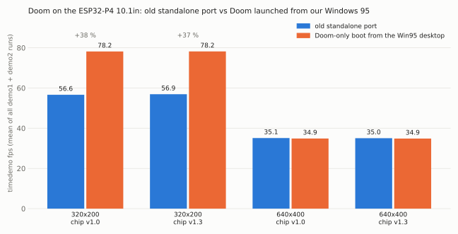
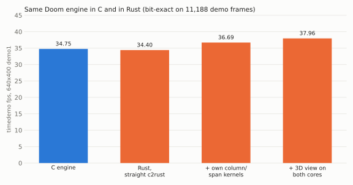

# Performance

All numbers come from the real boards (JC8012P4A1, ESP32-P4 chip v1.0 = "board A" and v1.3 = "board B"), from our lab reports.
Timedemo = Doom's `-timedemo`, uncapped (no vsync wait); the tic count proves the whole demo played.

## Doom launched from Windows vs the old standalone port (21 Nov 2026)

| build | board | demo1 (5026 tics) | demo2 (3836 tics) |
|---|---|---|---|
| old standalone port, 320x200 | v1.3 | 57.28, 57.28 | 56.15 |
| old standalone port, 320x200 | v1.0 | 57.19, 57.06, 57.08 | 56.20, 55.96, 56.36 |
| **Doom app from Windows, 320x200** | v1.3 | **78.53, 78.53, 78.50** | **77.88, 77.83, 77.88** |
| **Doom app from Windows, 320x200** | v1.0 | **78.57, 78.32, 78.60** | **77.83, 77.83, 77.88** |
| old standalone port, 640x400 | v1.3 | 34.97, 34.95 | 35.19 |
| old standalone port, 640x400 | v1.0 | 35.10, 35.08, 35.10 | 35.12, 35.16, 35.14 |
| Doom app from Windows, 640x400 | v1.3 | 34.70, 34.83, 34.85 | 34.91, 34.90, 34.91 |
| Doom app from Windows, 640x400 | v1.0 | 34.85, 34.84 | 34.90, 34.91, 34.92 |

**320x200: +37 % (demo1 57.2 -> 78.5 fps; +37-38 % over all runs). 640x400: a tie at ~35 fps.** Chip v1.0 vs v1.3: identical within 0.3 %.

Why 640x400 does not go faster: per frame the PSRAM moves ~3.5 MB (render 0.25, 8-bit -> RGB565 convert 0.77, PPA 0.5 read + 2.0 write)
plus 2 MB of panel scan-out per refresh. The old port sat at the same wall. 35 fps is also Doom's fixed game tic rate, so normal play
is capped there anyway (the next steps in ROADMAP.md aim at smoother frames, not more tics).

### What each technique gave (640x400 unless noted)

| technique | effect |
|---|---|
| Doom-only boot (Windows off while playing) | whole PSRAM bus and both cores for the game; 320x200 +37 % |
| PPA scale + rotate on a core-1 present task | play ~20 -> ~28 fps (vsync) |
| 3 DPI frame buffers vs 2 (both with vsync) | 27.43 -> 34.80 fps (+27 %) |
| RV32 asm palette -> RGB565 kernel vs C | 34.33 -> 34.83 fps (+1.5 %) |
| panel clock 40 / 48 / 60 MHz | 35.50 / 34.83 / 33.68 fps; 48 kept (60 flashed white, 40 caps vsync at 34.6 Hz) |
| convert on core 1 beside an async PPA | slower (33.3 fps): the memory bus is the limit, not the CPU |
| PPA with vs without the 90-degree rotation | 21.4 ms vs 21.5 ms per 640x400 -> 800x1280 job: rotation is free, bytes are not |
| PIE SIMD for the convert / column drawers | not applicable: per-pixel table lookups, PIE has no gather load |

## Same engine in C and Rust (21 Nov 2026, chip v1.3, 640x400 demo1, same host code)

| build | fps | render ms/frame |
|---|---|---|
| C engine | 34.75 | 15.9 |
| Rust, straight c2rust translation | 34.40 | 16.3 |
| + own column/span kernels (grouped loads, 4 px per step) | 36.69 | 12.8 |
| + 3D view drawn by both cores (recorded draws, split at the work median) | **37.96 (+9.2 %)** | **10.4 (-35 %)** |

Bit-exact: frame and game-state hashes equal on all 11,188 frames of the three shareware demos after every step.
After merging sound and controls into one app: Rust 36.1 / C 32.2 fps (same demo).

## Sound cost (21 Nov 2026, chip v1.3)

| | fps (demo1) |
|---|---|
| no sound | 34.20 |
| music + effects | 33.17 (-3.0 %; budget was 2 %, open) |
| effects only | -0.75 % |

## Doom player experience (21 Nov 2026, board A, USB gamepad)

| measure | result |
|---|---|
| pad report -> game tic | avg 9-17 ms, max 60 ms |
| key -> game tic | avg 4-17 ms |
| touch -> game tic | avg 23 ms |
| input -> photon (stamped on the panel refresh clock) | p50 78 ms, p99 114 ms |
| frame time at 640x400 | p50 28.6 ms, p99 32.6 ms |

## Switching between Windows and Doom (21 Nov 2026, board A)

| step | before | after |
|---|---|---|
| ROM + bootloader (image verify kept) -> app start | 0.72 s | ~0.6 s |
| app start -> firmware id (codec, RTC, SD mount, panel, IDE, overlays) | 1.34 s | 0.89 s |
| golden overlay load | 1.23 s | 0.25 s (aligned 64 KB reads) |
| resume (snapshot read + decompress) | 0.49 s | 0.51 s |
| **quit Doom -> Windows desktop** | **4.3 s** | **2.6 s** |

Shortcut -> first Doom frame: ~2.5 s after the restart.

## Windows

| measure | result | date |
|---|---|---|
| golden snapshot resume (restore) | ~0.5 s (board A), 0.94-1.0 s (board B, slower SD card) | 20-21 Nov 2026 |
| cold boot to desktop | 76-87 s, typically ~82 s | 20-21 Nov 2026 |
| Windows clock minus real time | cold -0.13..-0.03 s, after resume +-0.13 s, 14.5 min running -0.29..+0.16 s | 21 Nov 2026 |
| touch -> cursor | 0.66 ms (was 56 ms); 0 px error over 200 taps | 15 Nov 2026 |
| pointer present | 1.5 ms (was 114 ms full frame); 0 work while idle | 14-15 Nov 2026 |
| x86 engine vs the starting point | CPU +28 %, boot 137 -> 110 s at the time (bit-exact) | 16 Nov 2026 |
| native GDI BitBlt | Control Panel cold open 73.7 -> 31.4 s, Explorer -34 % | 16 Nov 2026 |
| disk boot read stall | 4.7 s -> 0.66 s | 14 Nov 2026 |
| Windows clock drift (Rust timer) | 0.60 % -> 0.005 % | 14 Nov 2026 |
| Ultimate Doom attract loop on camera | 40 min, no hang, no reset | 22 Nov 2026 |

## Hardware ceilings we measured

- PSRAM: ~88 MB/s streaming past the L2 cache; panel scan-out at 52 Hz alone takes ~106 MB/s.
- No Zba/Zbb/Zbs/Zbc on chip v1.x; divide ~19 cycles, taken branch 3, multiply 2. Code can run from PSRAM; internal data RAM is not executable.
- `fence.i` does not publish rewritten code on the P4: use `esp_cache_msync` (C2M, then M2C for instructions).
- `esp_cache_msync` returns an error and does nothing unless start and size are 128-byte aligned; ignore it and DMA reads stale data (ghost cursors, smears).
